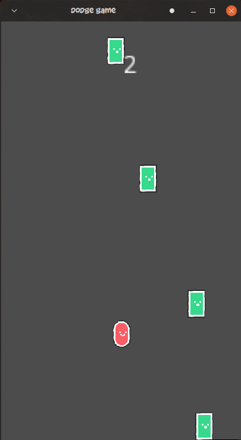

# Dodge the Creeps 🎮

A fast 2D dodging game built with **Godot 3.6.2**. Move your character, avoid the incoming creeps, and survive as long as you can. Your score goes up the longer you last.

Available on **Android** and **desktop (Linux)** **Windows will be made available soon**.

## Screenshot





## How to Play

- Dodge the creeps that fly in from the edges of the screen.
- One hit and it's game over.
- Your score is how long you survive.

### Controls

| Platform | Controls |
|----------|----------|
| Android | Touch and drag to move |
| Desktop | Arrow keys |

## Download

Get the latest build from the [Releases](../../releases) page:

- **Android:** download the `.apk` and install it
- **Linux:** download the zip, extract it, then run:
  ```
  chmod +x DodgeTheCreeps.x86_64
  ./DodgeTheCreeps.x86_64
  ```

## Run From Source

1. Install [Godot 3.6.2](https://godotengine.org/download/archive/3.6.2-stable/)
2. Clone this repo:
   ```
   git clone https://github.com/Mathias-San/dodge-the-creeps.git
   ```
3. Open Godot, click **Import**, and select `project.godot`
4. Press **F5** to play

## Built With

- [Godot Engine 3.6.2](https://godotengine.org/) (GDScript)

## Credits

Based on Godot's official *Dodge the Creeps* tutorial. Art and sound assets are from the kenney.nl, licensed CC-BY 3.0.

## License

Code released under the MIT License. See `LICENSE` for details.
